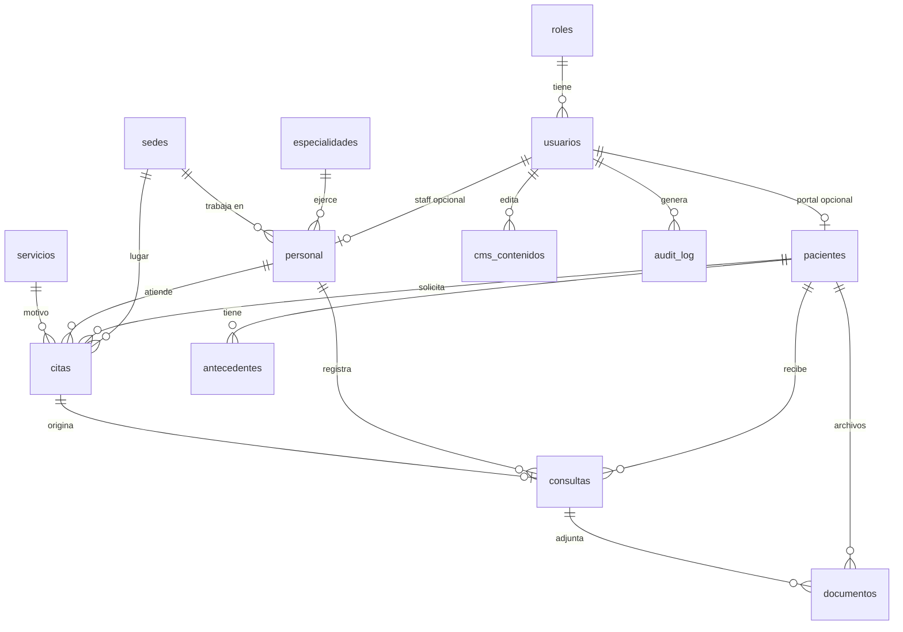

# Propuesta de esquema — Clínica Mi Doc (v3, normalizado)

Esquema **más compacto**: se eliminaron tablas 1:1 innecesarias, catálogos duplicados y KV redundantes.  
Sigue siendo multi-rol y deja previsto historial clínico sin inflar el modelo.

**SQL ejecutable:** [`sql/schema.sql`](sql/schema.sql) (DDL + datos semilla).

---

## 1. Qué se eliminó / fusionó (y por qué)

| Antes (v2) | Ahora (v3) | Motivo |
|------------|------------|--------|
| `medicos` + `enfermeros` | Todo en `personal` (`tipo`) | Evita tablas 1:1 casi vacías |
| `medico_especialidades` (N:M) | `personal.especialidad_id` | Un médico ↔ una especialidad principal basta; N:M se puede agregar después |
| `usuario_roles` (N:M) | `usuarios.rol_id` | Un rol activo por cuenta; más simple y sin redundancia |
| `historiales_medicos` | — | Cabecera 1:1 con paciente; el historial = `antecedentes` + `consultas` |
| `diagnosticos`, `recetas`, `receta_items`, `signos_vitales`, `evoluciones` | Campos / JSON en `consultas` + `antecedentes` | Misma información clínica sin 5 tablas hijas prematuras |
| `cita_estados` | ENUM en `citas.estado` | Estados estables; no hace falta catálogo |
| `horarios_atencion` | Texto en `sedes` o `cms_contenidos` | Evita tabla extra hasta que haya agenda real |
| `configuracion` + `contenido_landing` | Una sola `cms_contenidos` | Ambos eran clave-valor; unificar |
| `visitas` + `visitas_diarias` | Solo `visitas` | El agregado diario se calcula con `GROUP BY`; se evita doble escritura |

---

## 2. Diagrama

---

## 3. Tablas (14) — qué guarda cada una

### Identidad

#### `roles`
Catálogo de roles del sistema.  
**Guarda:** nombre legible, `slug` (`super_admin`, `admin`, `doctor`, `enfermero`, `recepcion`, `paciente`), descripción y si está activo.  
**No guarda:** usuarios (eso va en `usuarios`).

#### `usuarios`
Cuentas que pueden iniciar sesión.  
**Guarda:** email, hash de contraseña, nombre visible, `rol_id`, flag activo, último login, timestamps, `deleted_at` (soft delete).  
**No guarda:** datos clínicos ni demográficos de paciente (van en `pacientes` / `personal`).

---

### Organización

#### `sedes`
Ubicaciones físicas de la clínica (hoy una: Saint Jude; mañana más).  
**Guarda:** nombre, dirección, teléfono, mapa/URL, horarios en texto, si es principal, activo.

#### `especialidades`
Catálogo médico (Cirugía general, Pediátrica, Torácica, etc.).  
**Guarda:** nombre, slug, descripción corta, activo.

#### `servicios`
Prestaciones / motivos que salen en la landing y en el select del formulario de cita.  
**Guarda:** slug, título, descripción, icono, imagen, orden, flags activo/destacado.  
**No guarda:** citas (solo se referencian desde `citas`).

---

### Personas

#### `personal`
Todo el staff clínico-administrativo (doctor, enfermero, recepción, etc.).  
**Guarda:** `usuario_id` (opcional), `sede_id`, `especialidad_id` (útil sobre todo si `tipo=doctor`), `tipo` (`doctor`|`enfermero`|`recepcion`|`otro`), nombres, matrícula/licencia, bio, foto, activo, soft delete.  
**Reemplaza** las tablas separadas `medicos` / `enfermeros`.

#### `pacientes`
Ficha demográfica del paciente. Puede existir **sin usuario** (cita web pública).  
**Guarda:** `usuario_id` NULL (portal futuro), nombres, apellidos, tipo/nro documento, teléfono, email, fecha de nacimiento, sexo, grupo sanguíneo, notas administrativas, soft delete.  
**No guarda:** diagnósticos ni evolución (van en `consultas` / `antecedentes`).

---

### Operación diaria

#### `citas`
Solicitudes y agenda. Entrada principal del formulario público → bandeja del admin.  
**Guarda:**  
- Contacto del form: `nombre_contacto`, `telefono_contacto`, `mensaje`  
- Vínculos opcionales: `paciente_id`, `servicio_id`, `medico_id`→`personal`, `sede_id`  
- Agenda: `fecha_solicitada`, `fecha_confirmada`  
- `estado` ENUM: `pendiente` | `contactado` | `confirmada` | `cancelada` | `atendida`  
- `origen` (`web_publica`, `admin`, `telefono`, `otro`)  
- `notas_internas`, `ip`, `user_agent`, `leida_at`, timestamps  

**Flujo actual:** inserta con contacto + servicio + `pendiente`.  
**Futuro:** vincular paciente formal, médico y horarios.

---

### Historial clínico (previsto; tablas vacías al inicio)

#### `antecedentes`
Antecedentes permanentes del paciente (no son una consulta puntual).  
**Guarda:** `paciente_id`, `tipo` (`alergia`, `quirurgico`, `familiar`, `cronico`, `habito`, `otro`), descripción, fecha aproximada, activo, quién lo registró (`registrado_por`→`usuarios`/`personal`).

#### `consultas`
Encuentro clínico (el “núcleo” del historial). Puede nacer de una cita.  
**Guarda:** `paciente_id`, `cita_id` NULL, `profesional_id`→`personal`, fecha/hora, motivo, anamnesis, exploración, **diagnóstico** (texto; CIE opcional en el mismo registro), **indicaciones/receta** (texto), **signos vitales** (columnas simples o un JSON compacto: peso, TA, FC, temp), plan de seguimiento, timestamps.  
**Evita** tablas hijas prematuras (`diagnosticos`, `recetas`, `signos_vitales`, `evoluciones`). Si un día hay múltiples diagnósticos CIE formales o farmacia detallada, se parten desde aquí.

#### `documentos`
Archivos asociados a paciente o a una consulta (estudios, consentimientos, PDFs).  
**Guarda:** `paciente_id`, `consulta_id` NULL, tipo, nombre original, path/URL, mime, tamaño, subido_por, created_at.

---

### Sitio web y métricas

#### `cms_contenidos`
Único almacén clave-valor del sitio (textos, imágenes, SEO, teléfono, etc.).  
**Guarda:** `seccion` (`hero`, `seo`, `ubicacion`, `config`, …), `clave` única (`hero.titulo`, `config.telefono`), `tipo` (`texto`|`html`|`imagen`|`url`|`numero`), `valor`, etiqueta para el admin, `updated_by`, `updated_at`.  
**Sustituye** `contenido_landing` + `configuracion`.

#### `visitas`
Eventos de visita a la web (dashboard).  
**Guarda:** fecha, `ip_hash`, página, referrer, user_agent, created_at.  
Totales del dashboard = consultas `COUNT` / `COUNT DISTINCT` por día (sin tabla espejo).

#### `audit_log`
Bitácora de acciones del panel (quién cambió qué).  
**Guarda:** `usuario_id`, acción (`login`, `update`, `delete`…), tabla afectada, id del registro, snapshot JSON opcional, IP, created_at.

---

## 4. Lista final (14 tablas)

1. `roles`  
2. `usuarios`  
3. `sedes`  
4. `especialidades`  
5. `servicios`  
6. `personal`  
7. `pacientes`  
8. `citas`  
9. `antecedentes`  
10. `consultas`  
11. `documentos`  
12. `cms_contenidos`  
13. `visitas`  
14. `audit_log`  

---

## 5. Roles (datos de catálogo en `roles`)

| slug | Uso |
|------|-----|
| `super_admin` | Todo (usuarios, roles, config crítica) |
| `admin` | Dashboard, citas, CMS |
| `doctor` | Citas/consultas asignadas (futuro) |
| `enfermero` | Apoyo clínico (futuro) |
| `recepcion` | Alta/gestión de citas (futuro) |
| `paciente` | Portal del paciente (futuro) |

Un usuario = **un** `rol_id`. Si más adelante alguien necesita dos roles, se agrega pivot; no lo adelantamos vacío.

---

## 6. Soft delete

`deleted_at` en: `usuarios`, `personal`, `pacientes`, `citas`, `servicios`.  
El resto (catálogos, visitas, audit) no lo requiere o se archiva por `activo`.

---

## 7. Uso ahora vs después

| Ahora | Tablas |
|-------|--------|
| Login admin | `roles`, `usuarios` |
| Landing editable | `cms_contenidos`, `servicios` |
| Form cita → admin | `citas` (+ `servicios`) |
| Dashboard visitas/citas | `visitas`, `citas` |

| Después (ya modelado) | Tablas |
|-----------------------|--------|
| Staff / médicos | `personal`, `especialidades`, `sedes` |
| Ficha paciente | `pacientes` |
| Historial | `antecedentes`, `consultas`, `documentos` |
| Trazabilidad | `audit_log` |

---

## 8. ¿Se perdió capacidad a futuro?

No de forma grave:

- Varios roles por usuario → se agrega `usuario_roles` sin romper `usuarios`.  
- Varias especialidades por médico → se agrega pivot.  
- Recetas estructuradas / CIE múltiples → se parten desde `consultas`.  
- Agregados de visitas muy pesados → se puede crear `visitas_diarias` como materialización.

Se prioriza **menos tablas y una sola fuente de verdad** por concepto.

---

## 9. Cómo importar

1. Abre phpMyAdmin → pestaña **SQL**.
2. Ejecuta el contenido de `sql/schema.sql` (crea `clinica_mi_doc`, tablas y seeds).
3. Login bootstrap: `admin@clinicamidoc.com` / `AdminMiDoc2026!` (cambiar antes de Hostinger).

**Seed incluido:** roles, super_admin, sede Saint Jude, especialidades, servicios, personal (Dr. Hernán), CMS landing, 1 cita de ejemplo, visitas de demo, audit de import.

**Tablas vacías a propósito:** `pacientes`, `antecedentes`, `consultas`, `documentos`.
